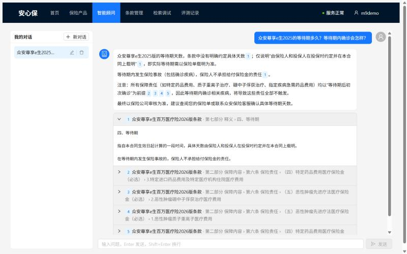
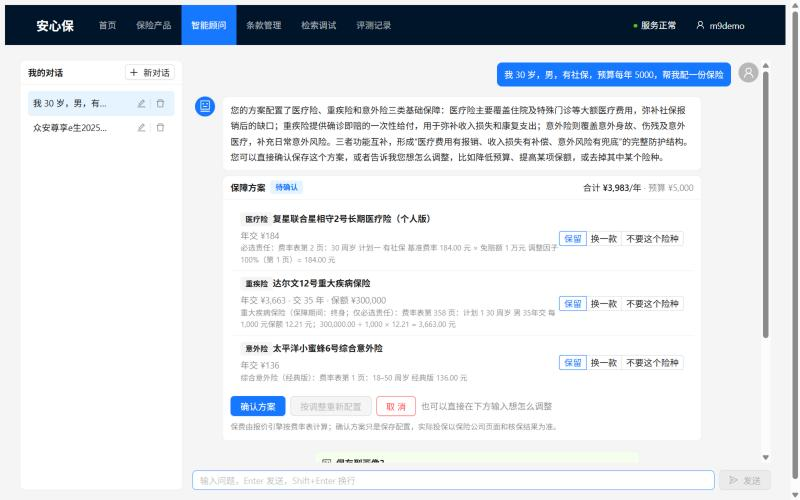
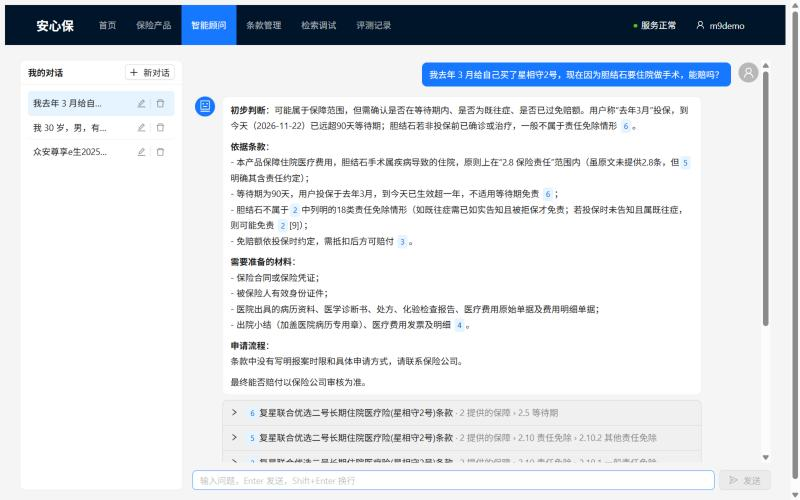
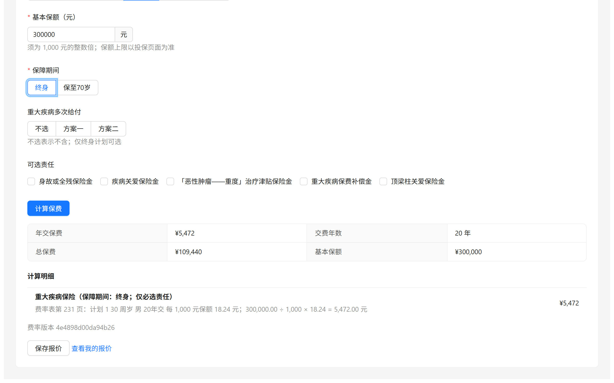
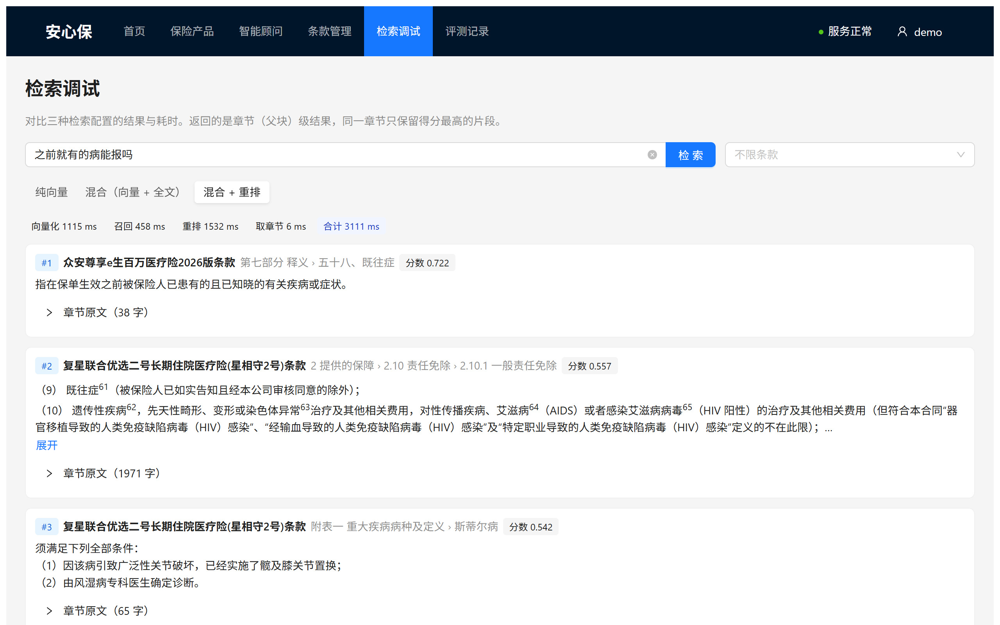
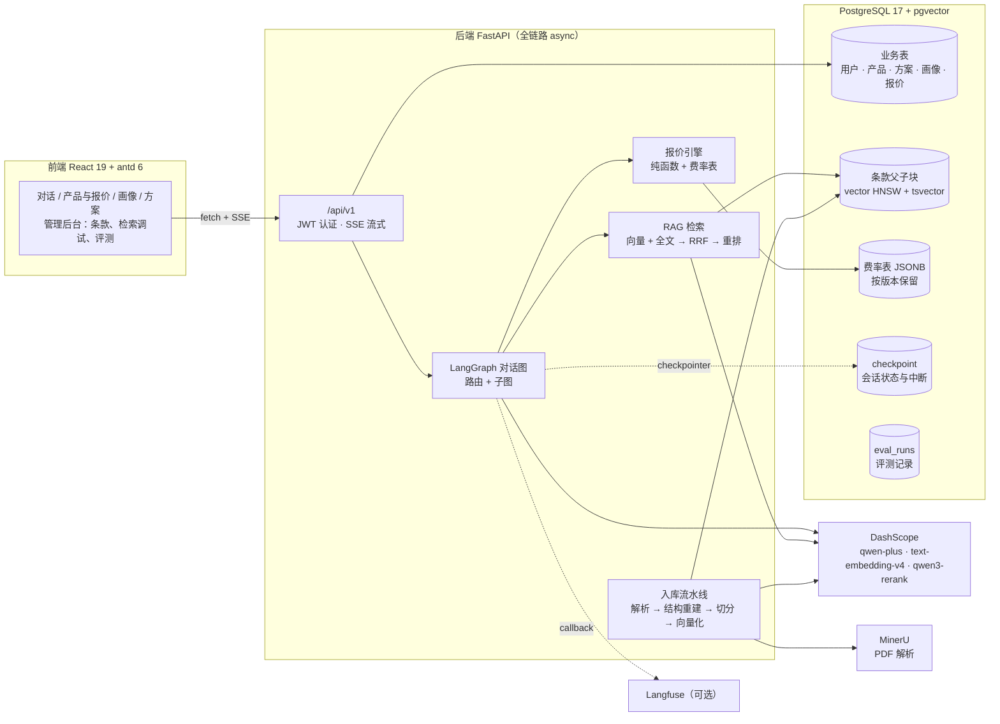
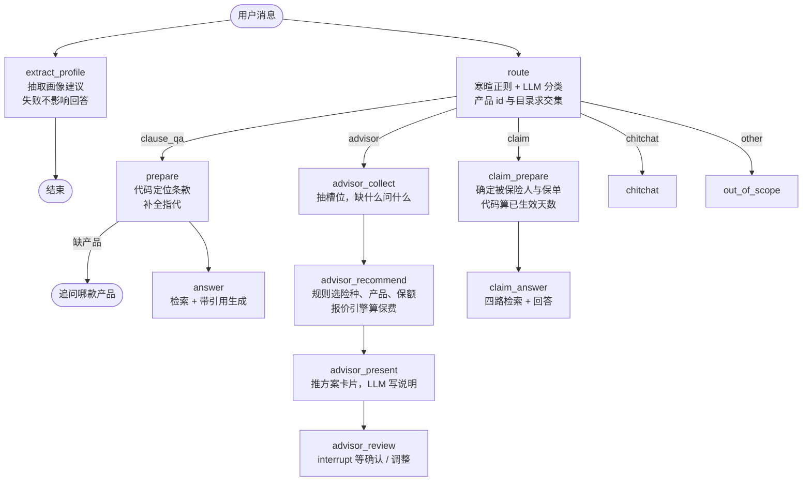
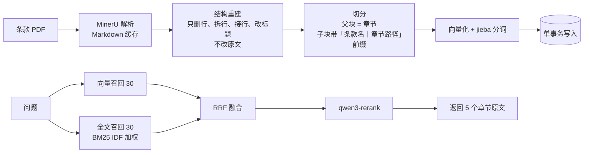

# 安心保 · 智能保险顾问

基于 RAG + LangGraph 的保险顾问 Agent：条款问答带出处、需求采集后按规则配方案、按费率表精确报价、理赔咨询，
加上一套可复现的评测（检索、路由、端到端、报价）。

核心原则：**LLM 只做「理解与表达」**。保费由纯函数按费率表计算，产品 id 必须在目录里，查哪份条款、检索参数由代码决定，
引用编号由代码校验，条款原文不经 LLM 改写。



## 功能

| 功能 | 说明 |
|---|---|
| 条款问答 | 混合检索（向量 + 全文）→ RRF → 重排；回答里的 `[n]` 由代码解析，只保留本轮真实检索到的编号；条款里没有就说没有 |
| 顾问 | 对话里收集年龄、性别、社保、预算；险种、产品、保额由规则选，LLM 只写说明；方案卡片用 LangGraph `interrupt` 等用户确认，也可以直接打字调整 |
| 报价 | 10 个产品的费率表从 PDF 提取成 JSON 并做业务校验；每行明细注明「费率表第几页、哪一格」，报价记录绑定费率表版本 |
| 理赔咨询 | 按用户的保单与投保日期，由代码算出已生效天数，同时检索保险责任、责任免除、等待期、理赔材料四处条款 |
| 长期画像 | 对话中抽取年龄、保单等信息，**用户点保存才写库**；之后的顾问和理赔自动带入 |
| 管理后台 | 条款上传与入库统计、检索调试（三种配置对比与耗时拆分）、评测记录 |
| 观测 | Langfuse 自托管（可选），trace 带用户、会话、节点耗时和 token 用量 |

<table>
<tr>
<td width="50%"><br>顾问：规则配方案，保费明细可追溯到费率表，等用户确认</td>
<td width="50%"><br>理赔咨询：已生效天数由代码计算，引用等待期与责任免除</td>
</tr>
<tr>
<td><br>产品页报价：费率表第 231 页、哪一格、怎么算</td>
<td><br>检索调试：三种配置切换，耗时拆分</td>
</tr>
</table>

## 架构



一个库解决一致性：条款块、向量、全文索引、业务数据、对话状态都在同一个 PostgreSQL 里，入库在单事务内完成，
「可检索」以 `documents.indexed_hash` 为准（重新入库失败时旧块仍可用）。

### 对话图

每轮消息进来，路由和画像抽取并行；路由只输出 `{intent, product_ids}`，代码校验后分发到子图。



- 回答 token 只转发 `answer` / `claim_answer` 节点；状态、引用、方案卡片、画像建议走 `get_stream_writer()` 的自定义事件。
- `interrupt` 只放在 `advisor_review`：恢复时被中断的节点会从头重跑，所以落库、调模型、推卡片都在它之前（spec D49）。
  会话停在确认处时，用户打字也会作为恢复值交给它（D48）。

### 条款入库与检索



## 评测结果

评测数字都来自 `eval_runs` 表（后台「评测记录」页可查），括号里是运行编号；报价来自单测，延迟来自 Langfuse trace。详细报告与失败案例见 [eval/README.md](eval/README.md)。

| 评测 | 数据集 | 结果 |
|---|---|---|
| 检索（混合 + 重排） | 生成集 166 题 / 手写口语难题集 34 题 | R@5 **1.000** / **0.941**，MRR 0.982 / 0.828（#67 / #70） |
| 检索三组对照 | 难题集 | 纯向量 R@5 0.794，混合 0.647（全文召回在口语题上是噪声），混合 + 重排 0.941 |
| 路由 | 测试集 203 题（多轮 55），另有开发集 51 题 | 准确率 **0.956**，宏 F1 0.952，多轮 0.964，产品识别 0.991（#143） |
| 端到端条款问答 | 86 题（12 题条款里没有答案） | 人工抽检正确性 **0.917**（两批各 15 道有答案题：0.933 / 0.900，#147 / #158 的 `metrics.human`）；无答案题拒答率 1.000、编造率 0；误拒率 0（#147） |
| LLM 裁判（qwen-max） | 人工盲标 17 题 | 正确性与人工一致 0.882（kappa 0.45），仍偏松，所以报数以人工抽检为准（#158） |
| 报价 | 对照 PDF 页面图像人工读出的抽样点 | 107 / 107 一致（单测） |
| 延迟 | 本机 compose，qwen-plus，Langfuse trace 3 轮 | 条款问答首 token 7.6–9.8 秒；每轮约 3.2–3.8k token |

<details>
<summary>评测方法上的几个坑（详见 <a href="docs/INTERVIEW.md">docs/INTERVIEW.md</a>）</summary>

- **生成集测不出差别**：LLM 照着条款出的题和原文太像，三种检索配置 R@5 都在 0.98 以上；手写的口语难题集才拉开差距。
- **评测集泄漏**：第一版查询改写的提示词示例照着难题集错题写，R@5「涨」到 0.971；去掉后只有 0.912，比不改写还差，于是线上只用改写补全指代。
  之后路由和裁判都分开发集 / 测试集，测试集只报告。
- **LLM 裁判要先量一致率**：v1 裁判和人工一致 76%，但 kappa 只有 0.15（绝大多数答案都是 correct）；改了两版后在新抽的盲标样本上报告。
</details>

## 技术栈

| 层 | 选型 |
|---|---|
| 后端 | Python 3.12、FastAPI、SQLAlchemy 2（async，asyncpg）、psycopg（LangGraph checkpointer）、Alembic、pydantic-settings、structlog、uv |
| Agent | LangGraph（`AsyncPostgresSaver` checkpointer、`interrupt`、自定义流事件）、LangChain OpenAI 兼容接口 |
| 模型 | DashScope：qwen-plus（对话）、qwen-max（评测裁判）、text-embedding-v4、qwen3-rerank；任何 OpenAI 兼容接口都能替换对话模型 |
| 检索 | PostgreSQL 17 + pgvector（HNSW）、jieba 分词 + `simple` 全文索引（不装中文分词插件） |
| 文档解析 | MinerU；费率表用 pdfplumber / pypdfium2 按单元格提取 |
| 前端 | React 19、antd 6、React Router、TanStack Query、Zustand、Vite、Vitest |
| 工程 | Docker Compose、GitHub Actions（ruff、mypy、alembic check、pytest 406 个用例；oxlint、tsc、vitest、build）、Langfuse 自托管 |

## 快速开始

前置：Docker Desktop、[uv](https://docs.astral.sh/uv/)、Node 24；DashScope API Key（向量化、重排、对话）；入库条款还需要 MinerU Token。

```powershell
# 1. 容器用的密钥写进 deploy/.env（已 gitignore）：compose 从这里读，变量名不带前缀
#    DASHSCOPE_API_KEY=...
#    MINERU_TOKEN=...
notepad deploy\.env

# 2. 一键起全套：前端 http://localhost:8080，后端 http://localhost:8000/docs
docker compose -f deploy/docker-compose.yml up -d --build
```

在宿主机上跑 `uv run`（入库、评测、本地开发）读的是另一份 `backend/.env`，变量名带前缀：
`copy backend\.env.example backend\.env`，填 `RAG__DASHSCOPE_API_KEY`、`RAG__MINERU_TOKEN`。

容器启动时自动执行迁移、写入演示产品和费率表。条款需要另外入库（条款 PDF 不在仓库里，放到 `data/raw/`）：

```powershell
cd backend
uv sync
uv run python -m app.rag ingest --all        # 条款入库：MinerU 解析 + 向量化
uv run python -m app.manage promote-admin <用户名>   # 在前端注册后，设为管理员才能看后台
```

### 本地开发

```powershell
docker compose -f deploy/docker-compose.yml up -d postgres   # 只起数据库（主机端口 5433）
cd backend;  uv run alembic upgrade head; uv run uvicorn app.main:app --reload
cd frontend; npm install; npm run dev                        # http://localhost:5173
```

Langfuse（可选）：在 `deploy/.env` 写入 `LANGFUSE_PUBLIC_KEY` / `LANGFUSE_SECRET_KEY` 后加 `--profile observability` 启动，打开 http://localhost:3000。

### 检查与评测

```powershell
cd backend;  uv run ruff check . ; uv run mypy app ; uv run alembic check ; uv run pytest
cd frontend; npm run lint ; npx tsc -b ; npm run test ; npm run build

cd backend
uv run python -m app.eval retrieval      # 检索三组对照（真实调用 DashScope）
uv run python -m app.eval routing        # 路由
uv run python -m app.eval e2e            # 端到端（qwen-max 裁判）+ 导出 20% 人工抽检 CSV
```

单测不访问网络（MinerU、DashScope 用假实现），每个数据库测试在外层事务里回滚；评测会真实调用模型，不进 CI。

## 目录

| 目录 | 内容 |
|---|---|
| `backend/app/agent/` | LangGraph 对话图、提示词、顾问规则、画像抽取 |
| `backend/app/rag/` | 入库流水线（parser → structure → chunker → embedder → pipeline）与检索（retriever、reranker） |
| `backend/app/pricing/` | 费率表提取与校验、报价引擎（纯函数），费率数据 `rates/*.json` |
| `backend/app/eval/` | 检索、路由、端到端评测与人工一致率 |
| `backend/app/api/v1/`、`services/`、`models/` | 路由、业务逻辑、ORM |
| `frontend/src/` | 页面、组件、`lib/`（请求、SSE、格式化）、`stores/`（Zustand） |
| `data/eval/` | 评测集（`*.jsonl`）；原始 PDF 与解析缓存不入库 |
| `eval/` | 评测报告与汇总 |
| `docs/` | [设计文档 SPEC](docs/SPEC.md)（决策 D1–D63、风险 Q1–Q27）、[面试故事集](docs/INTERVIEW.md)、[演示脚本](docs/DEMO.md) |

开发约定（也供 Claude Code 使用）见 [CLAUDE.md](CLAUDE.md)。

## 已知局限

- 顾问的推荐规则简单：每个险种取保费最低的可投保产品，不比较保障责任，也不看已有保障（spec Q19、Q21）。
- 端到端评测只覆盖条款问答；顾问、理赔还没有带标准结论的题集。
- 口语与条款术语之间的词汇鸿沟：难题集仍有 2 道未进前 5（心梗↔疾病免责、「刚买完就查出」↔等待期，Q14）。
- 理赔咨询首 token 12–15 秒（路由和抽取两次串行调用、四路检索各带重排，Q22）。
- 部分产品版本和附加责任不报价：费率表看不出区别的不猜（Q18）。

本项目是学习与求职作品，条款与费率表来自公开资料，回答和报价仅供演示，不构成投保建议。
